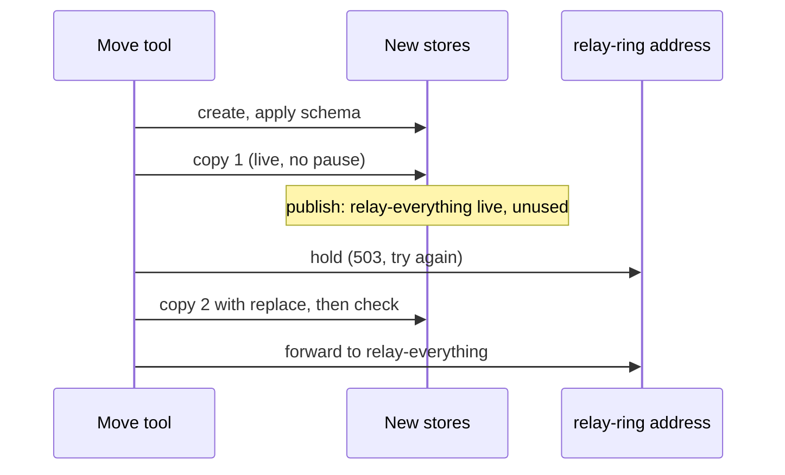

# Design

## Context

Every Cloudflare part of the private Relay site carries the name `relay-ring`:

| Kind | Today | Renames in place? |
|---|---|---|
| Worker (live, staging, local) | `relay-ring`, `relay-ring-staging`, `relay-ring-local` | No: a new Worker gets a new ID and a new workers.dev address |
| Live line Worker | `relay-ring-line` (Durable Object `Line`) | No |
| AI connector | `relay-ring-mcp`, `relay-ring-mcp-staging` (KV `OAUTH_KV` of sign-ins; Access for SaaS apps `relay-ring AI connector` and `(staging)`) | No: a new Worker gets a new address and a new KV |
| Check runner | `relay-ring-checks` (Worker, Workflow, container, R2) | No; unused since the GitHub move |
| D1 | `relay-ring-db`, `relay-ring-db-staging`, `relay-ring-memory` | No |
| R2 | `relay-ring-notes`, `relay-ring-notes-staging`, `relay-ring-memory` | No |
| Artifacts repo | `relay-ring-knowledge`; code repo `wongstack/relay-ring`, unused since the GitHub move | No |
| Access apps and policies | `WongStack relay-ring (relay-ring)` and `previews`, each covering exactly one Worker and its workers.dev address | No: an app covers one Worker, and the old one stays live until the switch |

Names live in `app/wrangler.jsonc`, `app/wrangler.line.jsonc`, `app/wrangler.relay-mcp.jsonc` (names, `RELAY_MCP_ADDRESS`, D1), `app/worker-configuration.d.ts` (generated), `app/package.json` (`db:migrate:*`), `.agents/.wong-stack.json` (`access.workers`, `memory`, `companyApi.origin`, `liveLine`, `knowledge`), `scripts/check-runner/wrangler.jsonc`, `scripts/relay-device-key.mjs` (hand-over folder `~/.relay-ring/device-keys`, token name prefix, default server address), `scripts/relay-mcp-setup.mjs` (the SaaS app's name), the fixtures in `scripts/publish-relay-site.test.mjs`, `scripts/relay-mcp-setup.test.mjs`, `scripts/relay-mcp-trial.test.mjs` and `scripts/check-private-access.test.mjs`, `wiki/stack/relay-ai-connector.md` and `AGENTS.md`. The build greps again first.

The app's D1 holds more than Relay: WongStack's access, inbox, schedules and task tables sit beside `relay_*`. The memory D1 has an FTS5 index fed by triggers and tables guarded by triggers (`facts_never_edited`, `facts_never_deleted`, owner-immutable triggers).

Access uses native Worker destinations: an app covers a Worker ID across its workers.dev address and custom domains. The Worker checks the signed assertion's audience (`CF_ACCESS_AUD`), not the host. Device service tokens belong to the account; an app's policy names them.

## Goals / Non-Goals

**Goals:** every Cloudflare name and every repo reference says `relay-everything`; the private site answers at `app.relayeverything.com`; no row or file is lost or doubled; health and location rows never leave the account; devices keep working without a new key.

**Non-Goals:** the public site's Workers (`relay`, `relay-staging`) keep their names; the phone app's code; the primary checkout's folder `/root/relay-ring` (the GitHub move owns the repo name).

## Decisions

### New Access apps that let in the same keys

Make two new Access apps, `WongStack relay-everything (relay-everything)` and its `previews` app, each a copy of the old one's settings and policies: the same people, the same checker token, and the same device service tokens in its `Relay devices` policy. Service tokens belong to the account, not to an app, and the Worker finds a device by its Client ID in `relay_devices`, which the copy moves. So every device key and the checker pass at the new address with no new key, and `RELAY_CHECKER_SHA256` stays. `CF_ACCESS_AUD`, `CF_ACCESS_APP_ID` and `CF_ACCESS_WORKER_ID` take the new values. The old apps stay as they are, on `relay-ring` and `relay-ring-staging`, until day 30.

Why not rename and repoint the old apps: `check-private-access.mjs` needs an app's destinations to be exactly its own Worker and workers.dev address. Repointing the old app before the switch would take the login off the live old site and fail every other Relay chat's publish until this one merges; keeping both Workers in one app fails the check. Device service tokens keep their names: a name is a label, and `relay-device-key.mjs` gives new ones the new prefix.

### Make the new Workers before the config names them

`check-private-access.mjs` refuses a deploy whose Worker ID no Access app covers, and the config must name the ID. So the build first uploads a placeholder script to `relay-everything`, `relay-everything-staging` and `relay-everything-line` (a 404 for every request, no bindings) through the Workers API, reads their IDs, makes the new Access apps on them, and only then commits the IDs to `app/wrangler.jsonc` and `.agents/.wong-stack.json`. The production placeholder also takes the custom domain, so the build proves before the publish that the new app asks for the login at `app.relayeverything.com`.

A new Worker has no secrets, and Cloudflare never reads one back. So the build makes the live app's two keys again, as setup names them: `relay-everything-access` (the sign-in list key, recording the new apps' people policies) and `relay-everything-cloudflare-read`, each with the old key's permissions, and stores them on `relay-everything`. `RELAY_PEBBLE_SIGNING` goes on both new app Workers from the primary checkout's `app/.dev.vars` and `app/.dev.vars.staging`, the files `secrets:push` reads. Wrangler keeps secrets across deploys, so the publish finds them. The old `relay-ring-access` and `relay-ring-cloudflare-read` keys join the day-30 list.

### The address: a custom domain in the config

Production `app/wrangler.jsonc` gets `"routes": [{ "pattern": "app.relayeverything.com", "custom_domain": true }]`, as `site/wrangler.jsonc` does for the public site; staging gets `"routes": []`. The workers.dev address of `relay-everything` stays on as the login anchor. The deploy token needs Workers Routes edit on the `relayeverything.com` zone; task 1.1 checks it, for both this computer's token and the GitHub Actions deploy token `RelayEverything-deploy`.

- `scripts/relay-device-key.mjs` takes its default server from the production custom domain in `app/wrangler.jsonc`; `--staging` keeps the staging workers.dev address. Its hand-over folder becomes `~/.relay-everything/device-keys`; the switch runbook moves the existing folder (this computer only, mode kept).
- `scripts/publish-relay-site.mjs`: `privateValues` also takes each `routes[].pattern` from `app/wrangler.jsonc`, so a page naming `app.relayeverything.com` is refused. A page naming the public `relayeverything.com` still passes, since the guard matches the whole host.
- Memory and the company API: `.agents/.wong-stack.json` `memory.worker` → `https://app.relayeverything.com/_memory`, `companyApi.origin` → `https://app.relayeverything.com`. Each computer signs in once with `cloudflared access login https://app.relayeverything.com`.

### The AI connector

The connector gets new Workers, `relay-everything-mcp` and `relay-everything-mcp-staging`, at their workers.dev addresses (`RELAY_MCP_ADDRESS` `https://relay-everything-mcp.<subdomain>.workers.dev/mcp`), each with a new sign-in KV and a new Access for SaaS app, `relay-everything AI connector` (and `(staging)`). `scripts/relay-mcp-setup.mjs` makes all of it from the renamed config, as it did the first time; the CI deploy token can't make a KV, so setup runs before the publish. The main app's `RELAY_MCP` binding points at the new Worker.

An AI app connected to the old address keeps its sign-in only in the old Worker's KV, and OAuth ties it to that host, so a forward can't carry it. Instead, after the switch, the old `relay-ring-mcp` is deployed once more from a temporary config: the same code and secrets, its own KV, but bound to `relay-everything-db`. The Claude app keeps answering from current data for the 30 days; Matthew adds the new address in the Claude app when it suits him, and the old Worker and its SaaS app go in the day-30 list. The old staging connector gets no such deploy.

Why not `mcp.relayeverything.com`: the connector's sign-in callbacks and the setup script are built on the workers.dev address, and a custom domain adds a second address change for no gain to the person.

### The 30-day forwarder

After the switch, the `relay-ring` Worker runs `scripts/relay-forward/worker.mjs`, with no login in front of it:

- A browser page load (`GET` with `Accept: text/html`) answers `308` to the same path and query on `app.relayeverything.com`.
- Every other request goes on with `fetch` to the same path and query on `https://app.relayeverything.com`: method, body, the device's service-token headers and WebSocket upgrades, minus the old app's `Cf-Access-Jwt-Assertion` and cookie. The new address's Access app checks the token again and signs its own assertion.
- `MODE=hold` answers `503` with `Retry-After: 60` and *Relay is moving; try again in a minute* for every request. Used only during the switch.

Why not a plain redirect: Dart's `http` client follows redirects only for `GET` and `HEAD`, and a `301`/`302` turns a `POST` into a `GET`; the Pebble webhook's redirect handling is unknown. Why not a service binding: the old app's assertion carries the old audience, which the new site refuses.

Why no login in front: Cloudflare's login takes the service-token headers off a request before the Worker sees it (task 6.5 showed it), so a forwarder behind the old app can't hand the key on. So at the switch the old Access app moves off `relay-ring`: its domain and destination become the unused host `relay-ring-retired.<subdomain>.workers.dev`, which keeps the app, its audience and policies for a rollback. The forwarder holds no data and checks nothing: a request with no valid key gets the new address's login, and a page load gets the 308 before any login. Task 6.5 also showed a device key passing through it to `app.relayeverything.com`.

The forwarder has no bindings to data, so deploying it over `relay-ring` drops its D1, R2 and `LIVE_LINE` bindings. The deploy keeps the Worker's Durable Object migration tag; if Cloudflare refuses a script without the old `migrations`, the forwarder's config repeats them with no class. The staging rehearsal shows which.

Staging gets no forwarder: no device sends to the preview address.

### The copy runs in a one-off Worker

`scripts/cf-move-data.mjs` (general, not Relay-only) runs one move:

```text
node scripts/cf-move-data.mjs --d1 relay-ring-db=relay-everything-db \
  --r2 relay-ring-notes=relay-everything-notes [--d1 ...] [--r2 ...] \
  [--replace] [--check-only]
```

1. It writes a throwaway Wrangler config in a temporary folder (outside the repo) for a Worker `relay-everything-move`, binding each old and new store, with `workers_dev: true` and no routes. It makes a random key in memory, sets it as the Worker secret `MOVE_KEY` through stdin, deploys `scripts/cf-move-data/worker.mjs`, and calls it with the key in a header. The key is never printed or saved.
2. **D1:** for each ordinary table in the old database (`sqlite_master`, skipping `sqlite_*`, `_cf_*`, `d1_migrations`, and FTS5 virtual and shadow tables), it reads pages of rows by `rowid` and writes them with `INSERT OR IGNORE` in `db.batch`, a table after the tables its rows name; a link to a row of the same table goes in after the whole table. The new side's `AFTER` triggers are off during the copy and back after it, with each search index rebuilt: a trigger such as the webhooks change's outbox would else write an event again for every copied note. `--replace` updates a changed row on its primary key, never `INSERT OR REPLACE` (which deletes first), and leaves out each column a `BEFORE UPDATE OF` trigger names, such as a fact's words; a row-wide `BEFORE UPDATE` trigger with no `WHEN` keeps its table insert-only. The migration ledgers `d1_migrations` and `schema_migrations` are skipped: the schema step wrote the new side's.
3. **R2:** it lists the old bucket and copies each key whose new copy is missing or has another size or ETag, streaming `get` into `put` with the same HTTP and custom metadata.
4. **Check:** per table, `count(*)` both sides, and, in pages inside the Worker, each old row compared with the new row of the same `rowid` (or primary key): `missing` and `differ` counts. Per bucket, object count and total bytes both sides, and each old key's size and ETag on the new side. For the memory database, `facts_fts` row count equals `facts`. It prints `table <name> old=<n> new=<n> missing=<n> differ=<n> extra=<n> ok|mismatch` lines and a final `result=passed|failed`. A new side with extra rows passes, with an `extra=<n>` count for the record: the new site may already hold newer rows, and a row deleted on the old side after copy 1 stays on the new side. A row that differs fails, so a memory fact written to both stores under the same id is caught, not silently dropped.
5. It deletes `relay-everything-move` at the end, pass or fail. A Worker with no data, made by the move, needs no question.

The new databases get their schema first: the app's from `npx wrangler d1 migrations apply relay-everything-db --remote` (so `d1_migrations` matches the files), the memory's from the memory skill's migrations. The copy then fills rows only. `wrangler d1 export` and R2 downloads are rejected: they put the rows and recordings on this computer.

### The switch, rehearsed on staging first



`/ship` merges only when every task is ticked, and the hold must come after the merge's deploy. So the tasks end at copy 1, and the steps after the merge run as **the switch runbook** below, in the same chat right after `/ship`'s `finish`, the way the website's live deploy runs after its publish. Each step's result goes in the archived Decision log.

**Before the publish (tasks):** staging moves first, as the rehearsal: copy 1 and a timed copy 2 with `relay-ring-db-staging` / `relay-ring-notes-staging`, then the preview on `relay-everything-staging` shows the copied data. No hold on staging; `relay-ring-staging` serves its last version until day 30. Then production copy 1 (app D1, notes R2, memory D1 and R2) runs while the old site is live.

**The switch runbook, after `finish` merges:**

1. Wait for GitHub Actions to deploy `relay-everything-line`, `relay-everything-mcp`, then `relay-everything` against the new stores. Nothing sends to the new address yet, except the app's own 15-minute cron.
2. Deploy `scripts/relay-forward` over `relay-ring` with `MODE=hold`. The old app's stores now stay still.
3. Copy 2 with `--replace`, every pair, then the check; `result=passed` is required. Target: under 5 minutes, as measured on staging.
4. Deploy the forwarder again with `MODE=forward`, then move the old Access app off `relay-ring` to `relay-ring-retired`. Deploy the old `relay-ring-mcp` bound to `relay-everything-db`.
5. Through the old address with the checker token: a device route answers as at the new address; a page load gets 308. `node scripts/relay-device-key.mjs list` reads the new database.
6. On this computer: move `~/.relay-ring/device-keys/` to `~/.relay-everything/device-keys/`, run `cloudflared access login https://app.relayeverything.com`, and check that a memory `recall` and the live line answer at the new address.
7. `node scripts/publish-relay-site.mjs`; report its `result=` line.
8. Make the day-30 schedule, and write an open thread for Matthew's steps on his devices: the server address in the phone app and the Pebble webhook, and the new connector address in the Claude app.

A failure in step 3 leaves the hold on: rerun copy 2. If it still fails, move the old Access app back to `relay-ring` if step 4 moved it, redeploy the old `relay-ring` app from the commit before this change (the old stores are untouched) and report; the devices then keep working on the old address.

The live line's Durable Object state doesn't move: each computer puts it back on reconnecting ([the live line](../../../wiki/stack/live-line.md#its-own-worker)). The helper reconnects to the new `companyApi.origin` after the primary checkout pulls the change.

### Knowledge, check runner and code repo

The Artifacts repo `relay-ring-knowledge` is git: the build makes `relay-everything-knowledge`, pushes every ref with `git push --mirror` from a temporary clone, compares `git ls-remote` on both sides, and sets `WONG_KNOWLEDGE_REPOSITORY`.

The GitHub move left the check runner `relay-ring-checks`, the Artifacts code repo `wongstack/relay-ring` and the `relay-ring-deploy` token unused, kept as its fallback until this change. They get no new name. The build removes the `CODE_CHECKS` binding from `app/wrangler.jsonc` (the code reader treats it as optional; `npm test` proves it), and `scripts/check-runner/` unless WongStack's GitHub route or install record needs it. The Cloudflare parts go in the day-30 list.

### Day 30

A schedule on day 30 (one-shot, `/schedule`) asks Matthew, with the copy's counts, to delete: `relay-ring`, `relay-ring-staging`, `relay-ring-line`, `relay-ring-db`, `relay-ring-db-staging`, `relay-ring-memory` (D1 and R2), `relay-ring-notes`, `relay-ring-notes-staging`, `relay-ring-knowledge`, `relay-ring-mcp` and `relay-ring-mcp-staging` with their KVs and SaaS apps, the two old Access apps, the keys `relay-ring-access` and `relay-ring-cloudflare-read`, and the GitHub move's fallback: `relay-ring-checks` (Worker, Workflow, R2 bucket `relay-ring-checks`), the Artifacts repo `wongstack/relay-ring`, and the API token `relay-ring-deploy`. On his yes, it deletes each and lists what it deleted. Before deleting a D1, it takes `wrangler d1 time-travel info` for the record; the bookmark is gone with the database, so the yes is final.

## Risks / Trade-offs

- **A ring note in a long hold is lost** if the hold passes Pebble's ~10-minute retry. Mitigation: staging measures copy 2; a production hold over 5 minutes switches to forward and reruns copy 2 after, accepting that an edit in that gap may need a third pass.
- **The deploy token lacks zone rights for the custom domain.** Task 1.1 checks before any change; a missing right is a key to add, not a code change.
- **The forwarder deploy refuses over a Worker with Durable Object migrations.** The staging rehearsal can't show this (staging has no line); task 6.5 tries it against a throwaway Worker with the same migration history first.
- **A memory fact written to both stores between copy 1 and copy 2** gets the same id on both sides. A fact's words never take replace, so the check reports it as `differ` and the move fails; the fix is to add the old fact again under a new id with the memory skill. Copy 2 runs right after the merge to keep the gap short.
- **A table with no rowid** (`WITHOUT ROWID`) can't page by `rowid`. The worker pages those by primary key; the test covers one.
- **Placeholders are public for a moment** between upload and Access coverage. They answer 404 with no bindings, so nothing leaks.
- **A device key made in the 30 days** goes only into the new app's policy, so it doesn't reach the old address. It doesn't need to: its QR code carries the new address.
- **Cost:** the copy Worker reads each row once per pass; at Relay's size this is far inside the free tiers.
