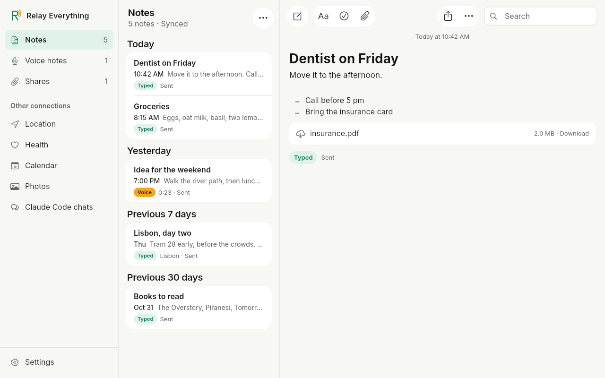
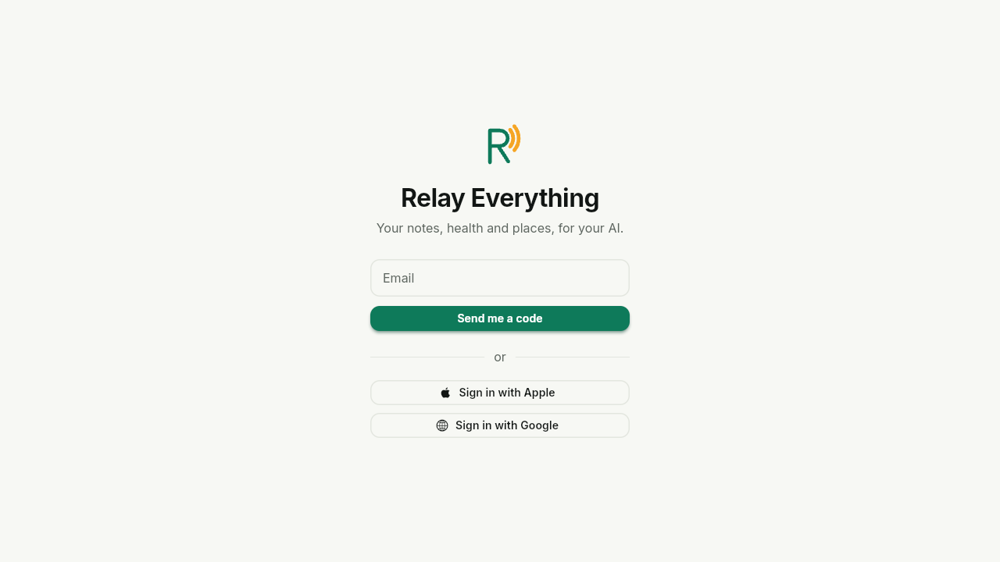
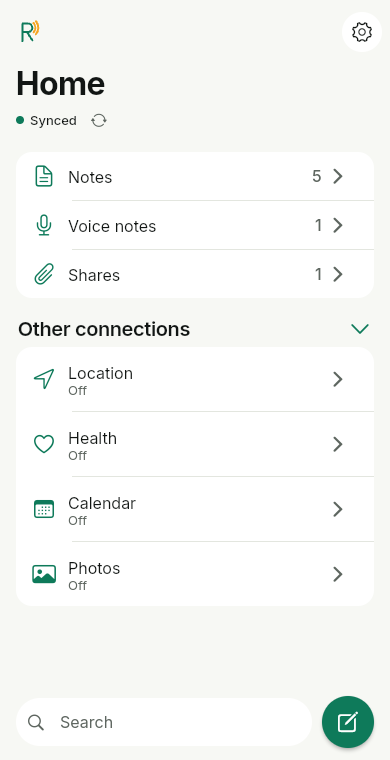
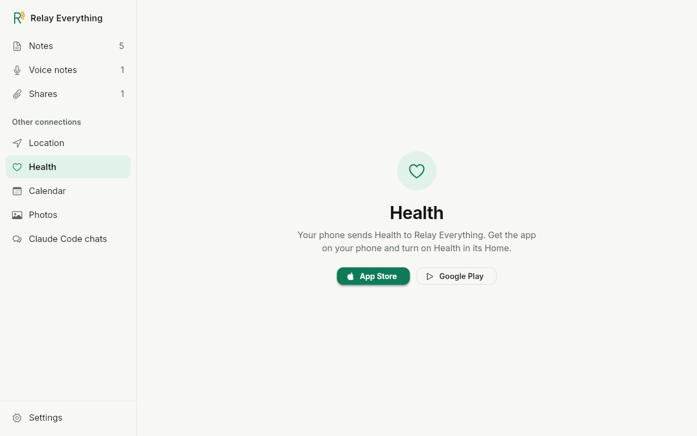

Relay Everything on a computer is the same app as on your phone, in a browser. Open `https://<your-relay-server>/` and sign in. You read, write, change and delete your notes there, and your phones get each change at their next sync.

## Sign in

1. Open `https://<your-relay-server>/`.
2. Enter your email, then click **Email me a code**.
3. Enter the code from the email.

Or click **Sign in with Apple** or **Sign in with Google**. The first sign-in makes your account: [Sign up](../../start/sign-up/). On [your own server](../../start/run-your-own/), you sign in with your server's own login, and your notes open at once.

To sign out, open [Settings](#settings), then **Account**, and click **Sign out**. The sign-in shows again.

## The layout

The layout follows the width of the window:

| Window width | What shows |
|---|---|
| 1,000 px or more | Three parts: the left bar, your notes, and the open note. |
| 700 to 999 px | The notes and the open note. The folders are in a menu. |
| Less than 700 px | The phone layout: one page at a time, as in the app on your phone. |

When you make the window narrower or wider, the open note stays open, with all the words you typed.

### The left bar

- **Notes**, with its count: one list of all your notes, as on the phone's Home. [Notes](../your-notes/#home)
- **Other connections**: **Location**, **Health**, **Calendar**, **Photos**, **Connect your AI** and **Email notes**. [Other connections](#other-connections)
- **Settings**, at the bottom. [Settings](#settings)

On the phone, Location, Health, Calendar and Photos are in **On this phone**, because the phone sends that data. On a computer, they are in **Other connections**.

### The notes and the open note

The middle shows your notes, newest first, with your pinned notes first in **Pinned**, then in groups by day: **Today**, **Yesterday**, **Previous 7 days**, **Previous 30 days**, then one group for each month. Above them, the filters **All**, **Voice** and **Photos and files** each show how many notes they hold: click one to see only its notes. [Filter your notes](../your-notes/#filter-your-notes) Each row shows the first line, the time, and the start of the words, with no tag. A note with a recording also shows a microphone and its length. A note from somewhere else also shows where it came from, such as *Email*. Click a row to open the note at the right.

### The top bar

One bar runs along the top, over the notes and the open note. Nothing is at the bottom of the window.

| Button | What it does |
|---|---|
| **New note** | Opens a new, empty note at the right. |
| **Aa** | Opens a menu under it: **B**, **I**, **U**, **S**, **Highlight** and its colors, then each line style and list in its own look, with ✓ at the current one, then **Block Quote**. A click styles the note, closes the menu, and the cursor stays in the note. [Text styles and checklists](../your-notes/#text-styles-and-checklists) |
| The checklist button | Makes the line a checklist item. |
| **Table** | Adds a table at the cursor. In a table, it offers **Convert to text** and **Delete table**. [Tables](../your-notes/#tables) |
| The paperclip | Adds photos or files to the open note. [Add photos and files](#add-photos-and-files) |
| **Share** | Shares the open note. |
| **⋯** | Opens the note's menu, with **Pin Note** (or **Unpin Note**), **Copy** and **Delete**, as on the phone. A pinned note shows first, in the **Pinned** group: [Pin a note](../your-notes/#pin-a-note) |
| **Search** | At the top right. [Search](#search) |

## Write and change notes

1. Click **New note**, or press Ctrl+Alt+N (⌘⌥N on a Mac). An empty note opens at the right.
2. Type. The first line is the note's title.

There is no **Save** button. The words go to your space as you type. To change a note, click it in the list, then click in its words and type. The styles, lists, checklists and links work as on the phone: [Open and change a note](../your-notes/#open-and-change-a-note). A paste with Ctrl+V (⌘V on a Mac) keeps the headings, lists, checklists, quotes, code, and bold, italic, underlined and struck-through words, reads Markdown as formatting, and keeps a link on its words and a table. It drops colors, fonts and pictures, as on the phone. A right-click in the words opens the browser's own menu, with its spell check.

Each change goes everywhere a phone's change goes:

- **Your phones** get it at their next sync. [Your notes on every phone](../your-notes/#your-notes-on-every-phone)
- **Your webhooks** get one [`note.created`](../../connections/your-database/#notecreated), [`note.updated`](../../connections/your-database/#noteupdated) or [`note.deleted`](../../connections/your-database/#notedeleted) message.
- **Your AI apps** read the new words.

A note that you write in the browser comes from the device **Web** in your space. Your webhooks, your AI apps and the web API see it by that name, as they see **Email** for a note from [email](../email/). The **Web** device has no key.

A change that you make on your phone shows in the browser when you come back to its tab. If the note is open, the change shows when you close the note.

If a change or a new note does not get to your space, for example because the connection is down, your words stay on the page. They go again at the next save, when you close the note, and when you come back to the tab. When you close the tab, the browser tries one more time, also with the words you typed just before. A file that did not upload shows as on its way, and goes again in the same way. Only a note that your space refuses leaves the page, with a message that says why.

## Add photos and files

Click the paperclip and pick files, or drag a file from your computer onto the open note. A note holds up to 10 files, each up to 25 MB, as on the phone: [Add photos and files](../your-notes/#add-photos-and-files).

A picture shows in its note. Another file shows as a row with its name and size: click it to download it.

## Delete a note

Open the note, click **⋯**, then **Delete**. Or press Ctrl+Shift+Backspace (⌘⇧Backspace on a Mac).

The note leaves the list and goes to **Recently Deleted** for 30 days. Press Ctrl+Z (⌘Z on a Mac) when you are not typing in a note to undo the last delete. Your phones show the note in **Recently Deleted** at their next sync. To recover a note, or delete it for good, open **Recently Deleted** in the left bar: [Recently Deleted](../your-notes/#recently-deleted)

## Keyboard keys

| To | On Windows and Linux | On a Mac |
|---|---|---|
| Start a new note | Ctrl+Alt+N | ⌘⌥N |
| Search | Ctrl+F | ⌘F |
| Bold, italic, underline | Ctrl+B, Ctrl+I, Ctrl+U | ⌘B, ⌘I, ⌘U |
| Strikethrough | Ctrl+Shift+X | ⌘⇧X |
| Highlight | Ctrl+Shift+E | ⌘⇧E |
| Title, Heading, Subheading, Body | Ctrl+Shift+T, H, J, B, or Ctrl+Alt+1, 2, 3, 0 | ⌘⇧T, H, J, B, or ⌘⌥1, 2, 3, 0 |
| Monostyled | Ctrl+Shift+M | ⌘⇧M |
| Bulleted, dashed, numbered list | Ctrl+Shift+7, 8, 9 | ⌘⇧7, 8, 9 |
| Checklist, tick an item | Ctrl+Shift+L, Ctrl+Shift+U | ⌘⇧L, ⌘⇧U |
| Block quote | Ctrl+' | ⌘' |
| Indent more, indent less | Ctrl+], Ctrl+[ | ⌘], ⌘[ |
| Link | Ctrl+K | ⌘K |
| Table | Ctrl+Alt+T | ⌘⌥T |
| Delete the open note | Ctrl+Shift+Backspace | ⌘⇧Backspace |
| Undo the last delete, when you are not typing | Ctrl+Z | ⌘Z |

The browser keeps some keys for itself. In Chrome, Ctrl+Shift+T opens a closed tab again, so use Ctrl+Alt+1 for a title there. You can also type Markdown marks at the start of a line, such as `## `: [Text styles and checklists](../your-notes/#text-styles-and-checklists)

The note uses the browser's own text editing, or the Mac's in the Mac app: its selection, spell check and find see the note's words. A triple-click selects one line.

## Search

Type words in **Search**, at the top right, or press Ctrl+F (⌘F on a Mac). The list shows only the notes with your words, in their text or in a recording's transcript. The open note stays open.

## Voice notes

A note shows each recording as its card, as on the phone: the one a voice note starts with above your words, and the others after them. Click **Play** to play the recording from your space. Click or drag on the line to go to that part, and click **Pause** to stop. The browser shows a plain line in place of the sound waves. Under the player, click the **Transcript** row to open the recording's page, with all of the words. Until the phone sends the recording, the card says the recording is still on your phone, and its **Transcript** row still opens the words.

The page and the Mac app record nothing: you record on your phone only, because the phone writes the words with its own speech model. [Voice notes](../voice-notes/)

## Other connections

Your phone sends your location, health, calendar and photos. In the browser, **Location**, **Health**, **Calendar** and **Photos** each open a page that says so, with links to the app for iPhone and Android. The browser does not show this data yet. Turn each one on in the app on your phone: [Location](../location/), [Health](../health/), [Calendar](../calendar/) and [Photos](../photos/).

The **Photos** page also shows how many photos your space holds, with **Delete all photos**: [Delete all photos](../photos/#delete-all-photos).

**Connect your AI** says *Let your AI read your notes*, and has two parts. **Claude Code and Codex** lists each computer connected with `/relay-connect`, with when it last saved a chat and **Disconnect**. Then **Saved chats** opens the chats that Relay Everything saved, newest first, each with its app. Search them, open one to read it, or delete it: [Read your chats](../../connections/claude-code/#read-your-chats). **Get the plugin** shows how to add it. **Claude, ChatGPT and other AI apps** shows the AI connector's address, with **Copy**, and each AI app you connected, with the day it connected and **Disconnect**: [Connect your AI](../../connections/connect-your-ai/).

**Email notes** says *Email a note to your own address*, and shows your two notes addresses, each with **Copy**. **New address** replaces the private one: [Email notes](../email/).

The browser shows no summary of your day, such as your steps, sleep, heart rate, events and places. Your AI can still read it: [Connect your AI](../../connections/connect-your-ai/#what-the-ai-can-read-and-add).

## Settings

Click **Settings** at the bottom of the left bar. Settings opens over your notes, with its pages at the left. Close it with the **X** at the top right: the open note stays as it was.

| Page | What it does |
|---|---|
| **Account** | Your email, *Signed in* and **Sign out**. Then **Phones**, **Advanced** and **Delete my account**. [Below](#account) |
| **Appearance** | How the app looks in this browser: System, Light or Dark. System follows your computer. The browser keeps it only until you reload the page. |

### Account

| Part | What it does |
|---|---|
| Your email and **Sign out** | Signs you out of this browser. |
| **Phones** | Each of your phones by name, each with **Sign out**. **Sign out** asks first, then stops that phone at its next request. The other phones and your computers go on. Use it for a lost or sold phone. [Connect a phone](../../start/connect-a-phone/#sign-out-a-lost-phone) |
| **Advanced** | **API keys**: *For your own scripts*. Lists your API keys, each with **Turn off**, and **Add an API key**, which shows a new key once. [Keys](../../api/keys/#make-list-and-turn-off-keys) **Webhooks**: add, test and remove the webhooks that send your data to your own database. [Add a webhook](../../connections/your-database/#add-a-webhook) |
| **Delete my account** | Last, in red. [Delete your account](../../start/sign-up/#delete-your-account) |

Your computers and AI apps are not in Settings: they are in **Connect your AI**, in the left bar. [Other connections](#other-connections)

On the phone, **Delete my account**, **Webhooks** and a tap on an AI app or a computer open this page in the phone's browser, at the matching page.

The phone's own settings, such as the switches for health, places, the calendar and photos, and the speech model, are only in the app on your phone: [Settings](../settings/).

An old link to a page of Settings still opens the matching page: `/#ai-apps` and `/#chats` open **Connect your AI**, `/#email-notes` opens **Email notes**, `/#webhooks` opens **Webhooks**, `/#devices` and `/#account` open **Account**, and `/#api-keys` opens **API keys**.

## The Mac app

The Mac app is Relay Everything in its own window, with the same layout as the browser. [Install it](../../start/install/#mac), then open **Settings** (⌘,) to sign in.

- **Your notes stay on the Mac.** You read and write them with no network, as on your phone. When you sign in, the Mac sends its notes, then gets your notes from your phones and the browser at once. After that, it sends each change, and gets the changes every few minutes and each time you come back to the window.
- **Settings** opens in the right part, not over your notes. It is the phone's own Settings, with Account, Appearance and Updates.
- **The menu bar** has **Check for Updates…**, **New Note** (⌘N), **Find** (⌘F) and **Settings…** (⌘,), and a **Format** menu with each item of the [keyboard keys](#keyboard-keys), as Notes on a Mac has it.
- **It updates itself.** When it opens, and once a day, it checks for a new version, and asks before it installs one. To check now, click **Check for Updates…** in the **Relay Everything** menu or in **Settings**. Each update is signed, and the app installs only an update with the correct signature.
- **Get test builds**, in **Settings** under **Updates**, also gets each new test build, which can have bugs. It is off, so you get only full releases. When you turn it off again, the app keeps its version until a newer full release comes.
- **Drop a file from Finder** on a note to add it. Each file can be up to 25 MB.
- **It leaves out Location, Health, Calendar and Photos.** Your phone sends them.
- **Recordings play.** A recording from your phone shows as its card with its transcript, and plays from your space, as in the browser: [Voice notes](#voice-notes). The Mac records nothing. Any other sound file on a note opens in the Mac's own player.

The Mac shows as *Mac* under **Phones** on your Account page. **Sign out** there stops it at its next request.

## What the browser keeps

The browser keeps no copy of your notes. It reads them from your space each time, and writes each change to your space. It keeps no key and no health or location data. When you sign out, none of your notes stay on the computer. This makes it safe to sign in on a computer that other people use too, if you sign out after.
