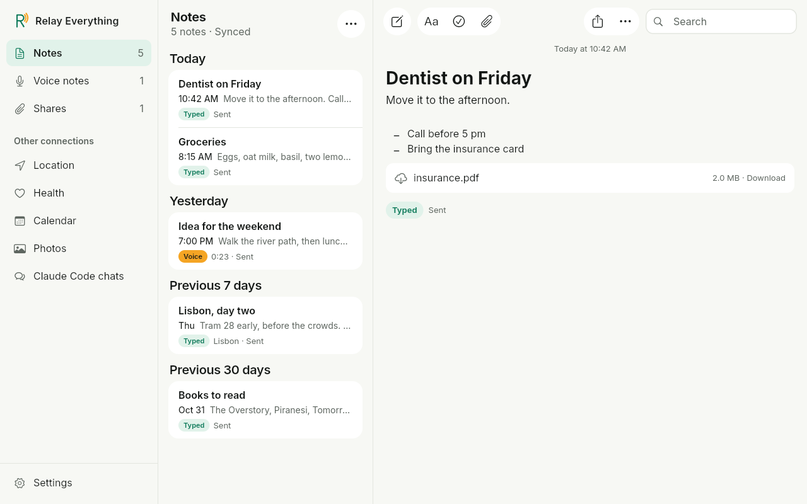
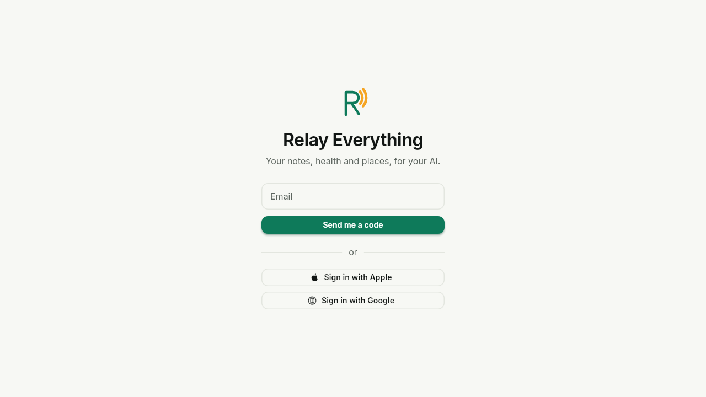
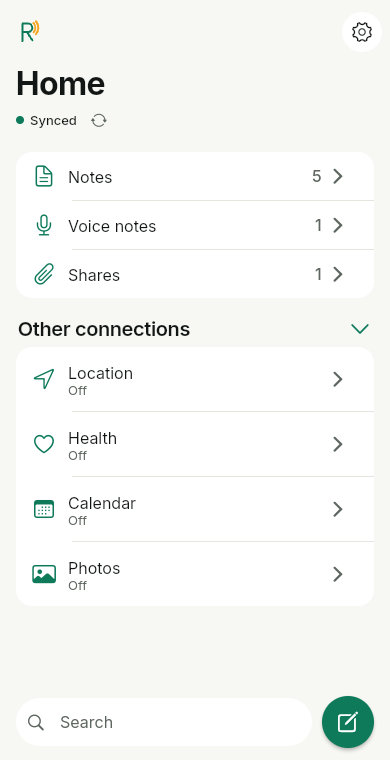
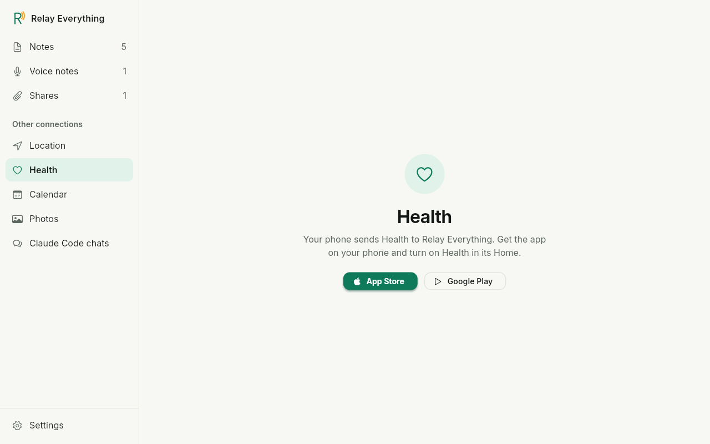
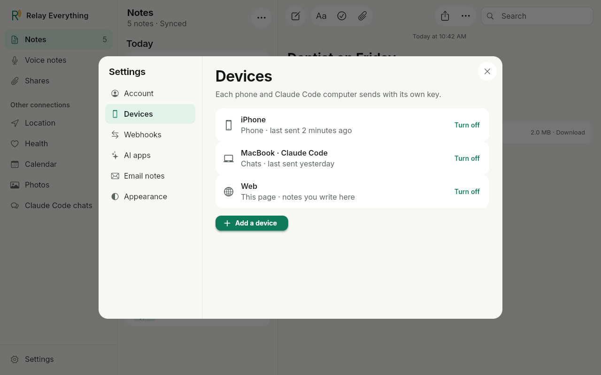

Relay Everything on a computer is the same app as on your phone, in a browser. Open `https://<your-relay-server>/` and sign in. You read, write, change and delete your notes there, and your phones get each change at their next sync.

## Sign in

1. Open `https://<your-relay-server>/`.
2. Enter your email, then click **Email me a code**.
3. Enter the code from the email.

Or click **Sign in with Apple** or **Sign in with Google**. The first sign-in makes your account: [Sign up](../../start/sign-up/). On [your own server](../../start/run-your-own/), you sign in with your server's own login, and your notes open at once.

To sign out, open [Settings](#settings), then **Account**, and click **Sign out**. The sign-in shows again.

## The layout

The layout follows the width of the window:

| Window width | What shows |
|---|---|
| 1,000 px or more | Three parts: the left bar, your notes, and the open note. |
| 700 to 999 px | The notes and the open note. The folders are in a menu. |
| Less than 700 px | The phone layout: one page at a time, as in the app on your phone. |

When you make the window narrower or wider, the open note stays open, with all the words you typed.

### The left bar

- **Notes**, with its count: one list of all your notes, as on the phone's Home. [Notes](../your-notes/#home)
- **Other connections**: **Location**, **Health**, **Calendar**, **Photos** and **Claude Code chats**. [Other connections](#other-connections)
- **Settings**, at the bottom. [Settings](#settings)

On the phone, the folders under **Notes** are in **On this phone**, because the phone sends that data. On a computer, they are in **Other connections**.

### The notes and the open note

The middle shows your notes, newest first, in groups by day: **Today**, **Yesterday**, **Previous 7 days**, **Previous 30 days**, then one group for each month. Above them, the filters **All**, **Voice** and **Photos and files** each show how many notes they hold: click one to see only its notes. [Filter your notes](../your-notes/#filter-your-notes) Each row shows the first line, the time, and the start of the words, with no tag. A voice note also shows a microphone and its length. A note from somewhere else also shows where it came from, such as *Email*. Click a row to open the note at the right.

### The top bar

One bar runs along the top, over the notes and the open note. Nothing is at the bottom of the window.

| Button | What it does |
|---|---|
| **New note** | Opens a new, empty note at the right. |
| **Aa** | Sets the text style. [Text styles and checklists](../your-notes/#text-styles-and-checklists) |
| The checklist button | Makes the line a checklist item. |
| The paperclip | Adds photos or files to the open note. [Add photos and files](#add-photos-and-files) |
| **Share** | Shares the open note. |
| **⋯** | Opens the note's menu, with **Copy** and **Delete**, as on the phone. |
| **Search** | At the top right. [Search](#search) |

## Write and change notes

1. Click **New note**, or press Ctrl+Alt+N (⌘⌥N on a Mac). An empty note opens at the right.
2. Type. The first line is the note's title.

There is no **Save** button. The words go to your space as you type. To change a note, click it in the list, then click in its words and type. The styles, lists, checklists and links work as on the phone: [Open and change a note](../your-notes/#open-and-change-a-note).

Each change goes everywhere a phone's change goes:

- **Your phones** get it at their next sync. [Your notes on every phone](../your-notes/#your-notes-on-every-phone)
- **Your webhooks** get one [`note.created`](../../connections/your-database/#notecreated), [`note.updated`](../../connections/your-database/#noteupdated) or [`note.deleted`](../../connections/your-database/#notedeleted) message.
- **Your AI apps** read the new words.

A note that you write in the browser comes from the device **Web** in your space. Your webhooks, your AI apps and the web API see it by that name, as they see **Email** for a note from [email](../email/). The **Web** device has no key.

A change that you make on your phone shows in the browser when you come back to its tab. If the note is open, the change shows when you close the note.

If a change or a new note does not get to your space, for example because the connection is down, your words stay on the page. They go again at the next save, when you close the note, and when you come back to the tab. When you close the tab, the browser tries one more time, also with the words you typed just before. A file that did not upload shows as on its way, and goes again in the same way. Only a note that your space refuses leaves the page, with a message that says why.

## Add photos and files

Click the paperclip and pick files, or drag a file from your computer onto the open note. A note holds up to 10 files, each up to 25 MB, as on the phone: [Add photos and files](../your-notes/#add-photos-and-files).

A picture shows in its note. Another file shows as a row with its name and size: click it to download it.

## Delete a note

Open the note, click **⋯**, then **Delete**. Or press Ctrl+Shift+Backspace (⌘⇧Backspace on a Mac).

The note leaves the list, and a bar says **Note deleted**, with **Undo**. Click **Undo** to get the note back, as on the phone. When the bar goes, or when you sign out or close the tab, your space deletes the note, its files and its recording, and your phones remove it at their next sync. [Delete a note](../your-notes/#delete-a-note)

## Keyboard keys

| To | On Windows and Linux | On a Mac |
|---|---|---|
| Start a new note | Ctrl+Alt+N | ⌘⌥N |
| Search | Ctrl+F | ⌘F |
| Make words bold | Ctrl+B | ⌘B |
| Make words italic | Ctrl+I | ⌘I |
| Delete the open note | Ctrl+Shift+Backspace | ⌘⇧Backspace |

You can select and copy the words of a note with the mouse.

## Search

Type words in **Search**, at the top right, or press Ctrl+F (⌘F on a Mac). The list shows only the notes with your words. The open note stays open.

## Voice notes

A voice note plays in the browser: open it and click **Play** in the player under the date. Click or drag on the line to go to that part, and click **Pause** to stop. The browser shows a plain line in place of the sound waves. You record voice notes on your phone only, because the phone writes the words with its own speech model: [Voice notes](../voice-notes/).

## Other connections

Your phone sends your location, health, calendar and photos. In the browser, **Location**, **Health**, **Calendar** and **Photos** each open a page that says so, with links to the app for iPhone and Android. The browser does not show this data yet. Turn each one on in the app on your phone: [Location](../location/), [Health](../health/), [Calendar](../calendar/) and [Photos](../photos/).

The **Photos** page also shows how many photos your space holds, with **Delete all photos**: [Delete all photos](../photos/#delete-all-photos).

**Claude Code chats** lists the chats that the Relay Everything plugin saved, newest first. Search them, open one to read it, or delete it: [Read your chats](../../connections/claude-code/#read-your-chats).

The browser shows no summary of your day, such as your steps, sleep, heart rate, events and places. Your AI can still read it: [Connect your AI](../../connections/connect-your-ai/#what-the-ai-can-read-and-add).

## Settings

Click **Settings** at the bottom of the left bar. Settings opens over your notes, with its pages at the left. Close it with the **X** at the top right: the open note stays as it was.

| Page | What it does |
|---|---|
| **Account** | Your email, **Sign out**, and **Delete my account**. [Delete your account](../../start/sign-up/#delete-your-account) |
| **Devices** | Each phone, Claude Code computer and script with a key. **Web**, the device of the notes you write in the browser, has no key, so it is not in the list. **Turn off** stops a key at once. **Add a device** makes a new key and shows it once, as a QR code and as text to copy. [Keys](../../api/keys/#make-list-and-turn-off-keys) |
| **Webhooks** | Add, test and remove the webhooks that send your data to your own database. [Add a webhook](../../connections/your-database/#add-a-webhook) |
| **AI apps** | The AI connector's address, with **Copy**, and the AI apps you connected, with **Disconnect**. [Connect your AI](../../connections/connect-your-ai/) |
| **Email notes** | Your secret notes address, with **Copy** and **New address**. [Email notes](../email/) |
| **Appearance** | How the app looks in this browser: System, Light or Dark. System follows your computer. The browser keeps it only until you reload the page. |

On the phone, **AI apps** and **Webhooks** on the **Account** page open this page in the phone's browser, with Settings open on **AI apps** or **Webhooks**.

The phone's own settings, such as the switches for health, places, the calendar and photos, the speech model and **Send to my own webhook instead**, are only in the app on your phone: [Settings](../settings/).

## What the browser keeps

The browser keeps no copy of your notes. It reads them from your space each time, and writes each change to your space. It keeps no key and no health or location data. When you sign out, none of your notes stay on the computer. This makes it safe to sign in on a computer that other people use too, if you sign out after.
