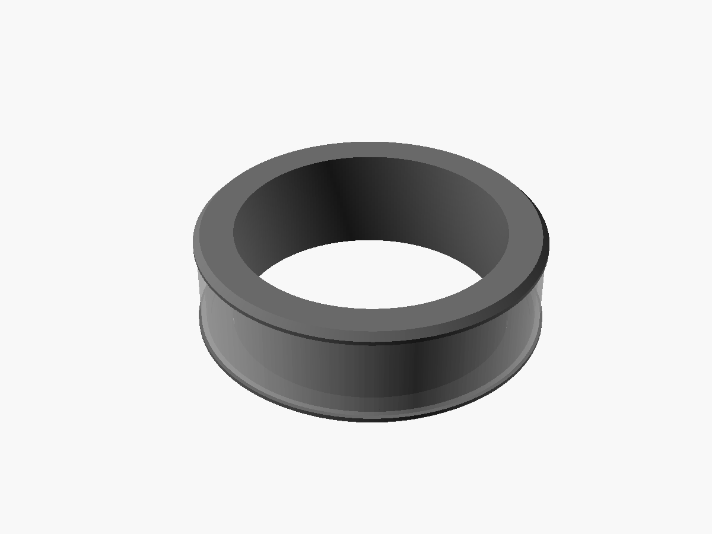

The Relay Everything ring records a note while you hold its band, like a walkie-talkie, and sends it to your phone when you let go.

:::caution[In design]
The Relay Everything ring is not built yet. The first version, V1, is in design and test prints. When it is ready, it will send through the Relay Everything phone app.
:::

## A note, start to end

1. **Hold the band.** The centre band clicks anywhere you press it: six small switches sit under it, around the ring.
2. **Talk.** The ring records only while you hold the band.
3. **Let go.** The ring sends the recording to your phone over Bluetooth.
4. **The phone sends it on.** The Relay Everything phone app keeps the note, and with sending on, it sends the note to your Relay Everything server, as it does a typed note.

## Against bumps

The whole band clicks, so a bump could start a note. Three rules stop it, with no extra parts:

1. **Hold to record.** The ring drops a press shorter than 0.5 s.
2. **No speech, no note.** The phone deletes a note with no speech in it. [Voice notes](../../app/voice-notes/#no-speech-no-note) in the app use the same rule.
3. **Raised edges.** The two edges stand 0.20 mm above the band. A table or a steering wheel touches the edges first; only a fingertip in the middle clicks.

## More about the ring

- [Parts and battery](../parts-and-battery/): the size, the battery and its life.
- [The board](../board/): the flexible board inside.
- [3D models and test prints](../models/): the prints that test the size and the click.
