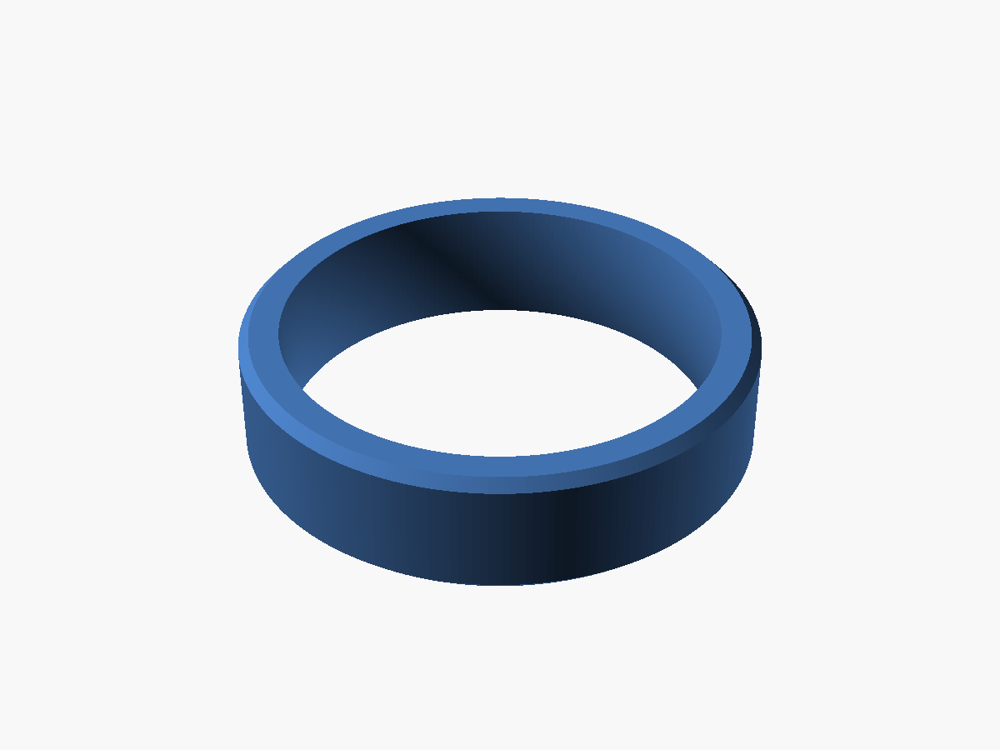
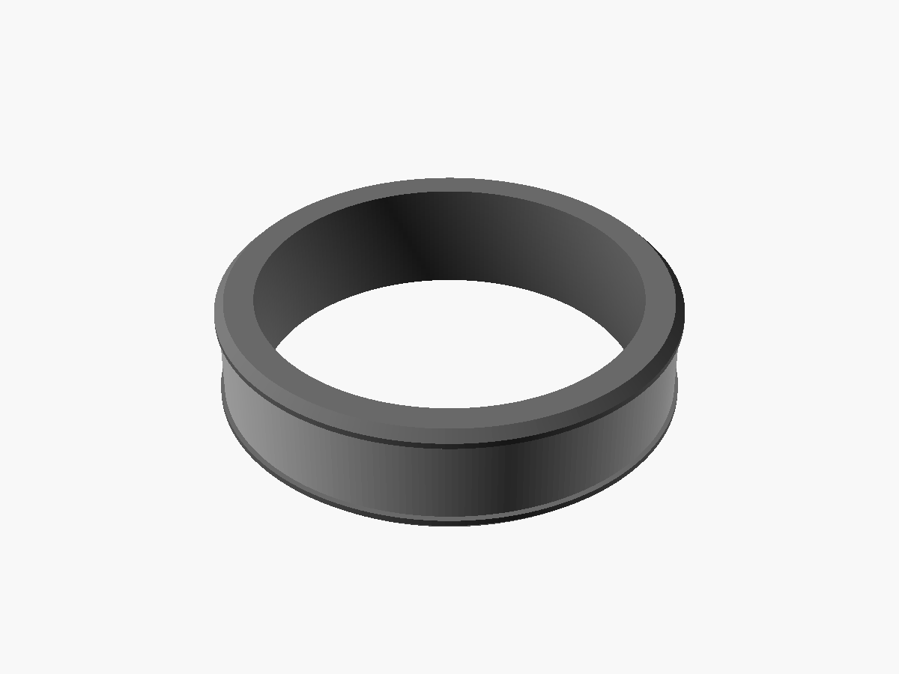
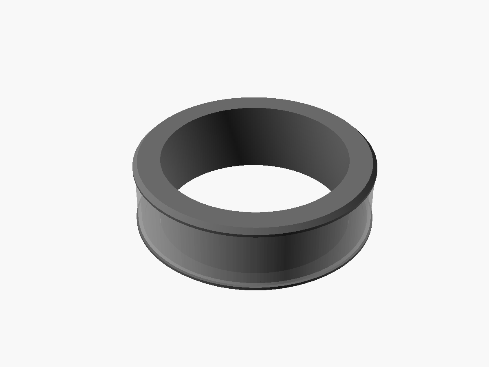

The Relay Everything ring is designed as 3D models in [OpenSCAD](https://openscad.org). Before the real ring, two test prints check the size and the click.

## Wear test

A plain ring in the final shape: 6 mm wide and 2.2 mm thick. Print it, wear it, and check the size and the feel. A second print has the V1 size, 8.0 × 2.9 mm.

## Click test

The floating band and its six switch seats, with no board. Drop the band on, and press it anywhere. It checks the click, and that the raised edges stop a flat press. A print twice the real size suits a print shop; a real-size print suits a home resin printer.

## V1 ring

The first real ring: a base, a cap and a band, with space for the battery, the board and six switches. The picture shows the parts inside.

[How it works](../how-it-works/) says how the ring records a note.
