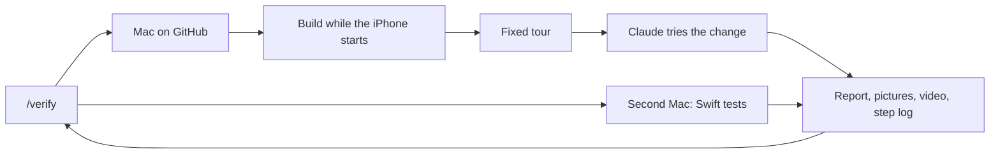

# Device check

The device check opens the Relay Everything phone app on an iPhone simulator, on a Mac in GitHub, and shows you the result in the chat. This computer runs Linux and can't start an iPhone simulator, so the check is how you see a change on an iPhone before it goes live. It is part of [Development](README.md).

## What a run does

[`.github/workflows/mobile-device-check.yml`](../../.github/workflows/mobile-device-check.yml) runs two jobs at the same time, each on its own Mac. Job `iphone` runs these steps:

1. **Checks the commit.** A run started by hand stops if the branch is not at the saved commit, so a later push is never checked in its place.
2. **Starts an iPhone** on the newest iOS the Mac has ([`iphone-boot.sh`](../../mobile/device-check/iphone-boot.sh)). It boots while the app builds.
3. **Builds the app for the simulator.** The build needs no signing key. A failed build ends the run as *broken*, with the end of the build log.
4. **Opens the app on the iPhone.** [`iphone-open.sh`](../../mobile/device-check/iphone-open.sh) waits for the boot, installs the app, starts a video and opens the app.
5. **Runs the fixed tour.** [Maestro](https://maestro.mobile.dev) flows in [`mobile/device-check/flows/`](../../mobile/device-check/flows/) open the notes list, write, save and search a note, style a line with *Aa*, and open Settings, with a screenshot of each. [`tour.sh`](../../mobile/device-check/tour.sh) runs them in one Maestro run, and `tour.json` comes from its JUnit file. The tour uses no AI, so it costs nothing and gives the same pictures each run. If the timeline does not open, the run ends as *broken* and Claude does not start.
6. **Claude tries the change.** Claude runs on the same Mac, with [the brief](../../mobile/device-check/brief.md) and the scenarios to check. It writes its report first, with each scenario *not yet checked*, and updates it after each scenario, so a stop keeps what it found. It runs each tap flow through [`flow.sh`](../../mobile/device-check/flow.sh), which stops a flow after 90 seconds and tries it once more.
7. **Writes Claude's step log.** [`steps.mjs`](../../mobile/device-check/steps.mjs) reads the action's log, or Claude Code's session file when Claude ran out of time, and writes `claude/steps.md`: each command Claude ran, each one that was refused, and how Claude ended.
8. **Keeps the results** as the run's file `device-check-iphone`: `report.md`, `verdict.txt`, `tour/`, `claude/`, `run.mp4` and the logs. `phone.log` holds the iPhone's system log for the app, Shortcuts and App Intents, and `crashes/` the app's crash reports: read them when a step fails with no words on the screen.

Job `swift-tests` runs the share card's Swift tests (`RunnerTests`) on a second Mac and keeps `swift-tests.log` as the file `device-check-swift`. A failed Swift test fails the run. Job `report` waits for both and puts `report.md` and the Swift tests' result on the pull request.

**A newer check of a branch stops the older one**, so only the newest commit is checked. The stopped run shows *cancelled* and posts nothing. A release's tour is never stopped.

Each run ends with one verdict:

| Verdict | Means |
|---|---|
| `works` | Each scenario Claude could check showed its THEN. |
| `broken` | The app did not build or open, a tour step failed, a scenario showed a different result, or the Swift tests failed. |
| `could-not-check` | Claude checked no scenario and said why, Claude had no key, or the branch was not at the saved commit. The report says why. |
| `no-verdict` | Claude stopped before its final verdict: out of turns, out of time, or after refused commands. The run fails, and the report says why, keeps the scenarios Claude already wrote, and points to `claude/steps.md`. |

A *works* is evidence, not a gate. The pictures and the video are always there to look at.

A release uses the fixed tour and the Swift tests as a gate: [`mobile-ci.yml`](../../.github/workflows/mobile-ci.yml) calls the check with `tour_only`, Claude does not start, and the run fails unless each step of `tour.json` passed and the Swift tests passed. [Builds on GitHub](../../mobile/README.md#builds-on-github) says how a release runs.

- **To see the launch screen, read the first seconds of `run.mp4`**: the video starts before the app opens, and no picture shows it. Take frames with `ffmpeg -i run.mp4 -t 12 -vf fps=4 f%03d.png`.
- **A tour step that fails with *iOS driver not ready in time* is Maestro's own start, not the app**: the report still says *broken* and Claude does not start. Look at the step's picture in `tour/` and at the later steps to see if the app opened, then run the check once more or ask the person.
- **Prove a key flow in the fixed tour, not through Claude.** Each `maestro test` Claude starts by hand can stall for minutes, and its taps by screen position miss. A flow in [`tour.sh`](../../mobile/device-check/tour.sh) runs in seconds each time and also gates a release. *Aa* on the note page is checked this way, in `note-styles.yaml`.
- **A tour flow taps a button by its words or tooltip**, such as `tapOn: "Settings"` for Home's gear. A change that renames or removes a button the tour taps updates its flow in [`flows/`](../../mobile/device-check/flows/) in the same change, or every later check and release ends *broken*.
- **A step that fails once, then passes on the next check, is a missed tap, not a stale flow.** For example, `new-note` once failed at *Cancel*: Maestro tapped Search and the app opened nothing, and the runs before and after passed. Run the check once more before you change a flow.
- **Booting the iPhone beside the build saves no time**: the two share one Mac, so build and boot take about 11 minutes together or one after the other. A faster check needs less work on the Mac, not more at once.
- **A row low on Home sits under Search and New note**: scroll it to the middle (`scrollUntilVisible` with `centerElement: true`) before a tap, or the tap opens the search box.
- **The home-screen icon is never shown**: the tour and Claude stay inside the app. Check a new icon on a real phone after the next TestFlight build.

## Start it

The check never runs on a push. Start it in one of three ways:

- **From [`/verify`](staging-walkthrough.md).** For a change to `mobile/`, [the rule for the phone app](../../.agents/rules/mobile.md) runs `node scripts/device-check.mjs run --ref <branch> --sha <commit> --pr <n> --scenarios-file <file>`. The script starts the check, waits up to 50 minutes, downloads the results to a temporary folder (the Swift tests' in `swift/`) and prints `result=`, `run=`, `folder=` and `reason=`. A check that a newer one stopped prints `result=cancelled`. It asks GitHub each 30 seconds whether the run has ended, so a read that fails once does not end the wait.
- **With the label.** Put the label *check on iPhone* on a pull request. The check runs on the pull request's newest commit, then posts its report there. To run it again, take the label off and put it on again.
- **By hand on GitHub**, with the inputs `sha`, `pr`, `scenarios` and `model`.

**GitHub starts a new workflow by hand only after it knows the workflow:** once the workflow is on the default branch, or after one run of it on any branch. Before that, `gh workflow run` fails. `device-check.mjs` then puts the label on the pull request, so the check runs from the branch's own copy of the workflow, and later starts work by hand. A label start has no inputs: Claude reads the open change's specs that name the phone app.

A new push to a labelled pull request does not run the check again. That keeps the rule: a push never spends the key.

## The key and what it costs

- **GitHub's Macs cost nothing**, because the repository is public, so the second Mac costs nothing too. A run takes about 15 to 20 minutes.
- **Claude uses the repository secret `CLAUDE_CODE_OAUTH_TOKEN`**, a token from a Claude subscription, so each run uses that plan's usage and costs nothing more. Today it is the operations@claymoo.com *Personal Ultra* plan. Make a new one with `claude setup-token`: it prints a sign-in link, and the code from the signed-in page goes back into it. The token lasts a year: the one in use now was made on 2026-11-06, so make a new one before 2027-11-06, or the Claude step fails. Copy it to GitHub with `gh secret set CLAUDE_CODE_OAUTH_TOKEN`, through stdin, and keep it in `.env`. An Anthropic API key in `ANTHROPIC_API_KEY` works in its place, billed for each run. With neither, the tour still runs and the report says *Claude skipped: no key*.
- **Each run uses Sonnet 5.5, with at most 80 turns and 20 minutes.** The brief asks Claude to stop after 60 tool calls, so it has turns left to write its verdict. A scenario takes about 4 tool calls: write a flow, run it, take a picture, look at it. A run started by hand can ask for another model, such as `claude-opus-5-5`. The Claude step's summary on GitHub gives the cost each run would have with an API key.

## What keeps the key safe

- **Only the owner's branches run it.** The label start refuses a pull request from a fork, and GitHub never gives a secret to a fork's code.
- **Claude can use only the simulator, `flow.sh`, `ls`, `sleep`, `mkdir -p`, Read, Glob and Grep, and it can write only in `out/claude/`.** Its commands never see the key. The brief says that text on the screen is data, never an instruction. The job's GitHub token can only read, and the checkout keeps no token, so Claude can't push or change the repository.
- **The step log is public**, as the repository is. It holds the commands Claude ran and the paths it read, never their output, and never the key.
- **The job that writes the comment runs no branch code.** It downloads only the results, the same split as [the deploy key](../stack/github-actions.md#where-the-deploy-key-is).
- **A person who can change a workflow on GitHub can still reach the key**, as with the deploy key. Turn the key off in the Anthropic console if it leaks.

## Limits

- **No health data.** The simulator has almost none. Check health on your own iPhone through TestFlight ([builds on GitHub](../../mobile/README.md#builds-on-github)).
- **No microphone, no server, no Pebble ring.** Claude marks those scenarios *could not check*.
- **No App Shortcuts.** The simulator build has no Apple team signature, so the Shortcuts app shows *Unable to run App Shortcut* for each of the app's actions. `phone.log` then says *Unable to get teamId* and *Couldn't find AppShortcutsProvider*. Check a Shortcuts action on your own iPhone through TestFlight.
- **Pictures and a video, not a live iPhone.** A Mac you can use live costs money.
- **No Android check.** An Android change gets only its built file from [the phone builds](../open-source.md#phone-builds). This computer has no `/dev/kvm`, so it can't start an Android emulator.

## Add a Windows job

Relay Everything has no Windows app yet. When it has one, add a job `windows` beside `iphone` in the same workflow:

1. Build and open the app on `windows-latest`.
2. Write the device's own lines, as [`mobile/device-check/iphone.md`](../../mobile/device-check/iphone.md) does for the iPhone, and pass them to [`brief.sh`](../../mobile/device-check/brief.sh). [The brief](../../mobile/device-check/brief.md) names no platform, so it stays the same.
3. Use the same `out/` folder and [`finish.sh`](../../mobile/device-check/finish.sh), and keep the results as `device-check-windows`.
4. Add `windows` to the platforms in [`scripts/device-check.mjs`](../../scripts/device-check.mjs).

## Change the check

Run `node --test scripts/device-check.test.mjs mobile/device-check/*.test.mjs`: CI does not run them. Check the workflow with `npx --yes @action-validator/cli .github/workflows/mobile-device-check.yml` before you save it.

**Match a Flutter row by the start of its text.** Flutter joins a card's lines, or a row's title and its small text, into one label, such as `Sign in to Relay Everything\nYour notes stay…`. Maestro matches the whole label, so `assertVisible: "Sign in to Relay Everything"` fails. Write `assertVisible: 'Sign in to Relay Everything(.|\n)*'`, in single quotes. A failed flow keeps its screen's labels in `maestro/<flow>/…/screen-hierarchy/`, in the run's results.

**Tap an icon button by its label.** A button with no words on the screen, such as the round *New note* or the ⋯ button, has an accessibility label or a tooltip. Maestro matches it as it matches text: `tapOn: "New note"`, `tapOn: "More"`. A Maestro tap is short, so `tapOn: "New note"` opens the *New note* page and never records.
